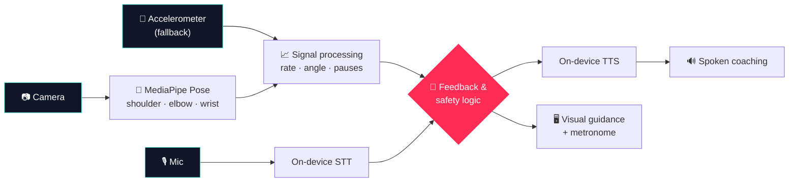

 

-5eead4?style=flat-square&labelColor=0e1628)

### *A CPR instructor that watches you, coaches you out loud, and speaks your language, with no internet needed.*

> [!IMPORTANT]
> **CPR Coach is a student hackathon prototype, not a medical device.** In a real emergency, **call 112** (or **108** for an ambulance in India), follow the dispatcher, and **start CPR right away**. Never delay care to set up a phone or wait for the app.

## 💔 The problem

Someone collapses at a railway station. A crowd gathers. Someone calls an ambulance.

**And nobody knows how to do CPR properly.**

Maybe someone watched a YouTube video once, or did a workshop years ago. Under stress, that memory goes. Most CPR apps don't help much either: they play a video or a metronome, but they can't tell whether you're doing it right. Most of them are also English-only, which leaves out a lot of India.

Hands-on training with feedback manikins works, but it needs instructors and expensive equipment that most colleges and communities don't have.

## ❤️ The idea

**CPR Coach turns an ordinary smartphone into a CPR instructor.**

The camera watches the rescuer's arms. The app works out how fast they're compressing, whether their elbows are locked, and whether they've stopped. Then it **tells them out loud**, in their own language:

**"Push faster."**&nbsp;&nbsp;·&nbsp;&nbsp;**"Keep your arms straight."**&nbsp;&nbsp;·&nbsp;&nbsp;**"Keep going."**

 

<i>Concept illustration. The numbers shown are examples, not measured results.</i>

## ⚡ How it works

| | Step | What happens |
|:-:|---|---|
| **1** | 🎯 **Point the camera** | Prop the phone up to see the rescuer's upper body from the side. |
| **2** | 🦴 **Track the arms** | MediaPipe follows the shoulder, elbow and wrist landmarks in real time, on the device. |
| **3** | 📈 **Read the rhythm** | Signal processing turns the up-and-down wrist motion into a compression rate, works out the elbow angle, and spots pauses. |
| **4** | 🔊 **Coach out loud** | Short spoken prompts from on-device TTS, so the rescuer never needs to look at the screen. |
| **5** | 🗣️ **Talk back** | On-device speech recognition handles simple voice commands, so you can use it hands-free. |

## 🧭 Two modes, one app

<table>
<tr>
<td width="50%" valign="top">

### 🎓 Training mode
**The main feature, and what we demo.**

Practise on a CPR manikin and get live feedback and a score at the end:

- Compression-rate consistency (target **100–120/min**)
- Elbow posture
- Pauses and interruptions
- Tracking quality, so you know how far to trust the score

Built for colleges, NSS units and community groups that can't afford feedback manikins.

</td>
<td width="50%" valign="top">

### 🚨 Emergency guidance
**Experimental. Safety first.**

- A big button that starts with **call 112 / 108**
- Clear CPR steps in your language
- A metronome you can hear at 110/min
- Optional camera coaching, only if it doesn't slow you down
- Still works if the camera, voice models or network fail

This needs proper clinical and usability testing before anyone should rely on it.

</td>
</tr>
</table>

## 🗣️ Speaks your language

CPR instructions are only useful if you understand them while panicking.

CPR Coach uses **on-device speech-to-text and text-to-speech models** that our team has already tested, aiming for **10 languages**. We're starting with **Kannada and English**. Everything runs locally, so there's no cloud API, no data leaving the phone, and no dead zones where it stops working.

> The final language list, model sizes and supported devices will be published after full integration testing. Every emergency instruction stays usable **without** voice.

## 🏗️ Architecture

### 🧰 Stack

| Layer | Tech |
|---|---|
| App | React / HTML · CSS · JS |
| Pose estimation | MediaPipe Pose Landmarker |
| Motion analysis | Browser-side signal processing + peak detection |
| Speech | Team-tested on-device STT & TTS models |
| Audio | Web Audio API + pre-recorded fallback prompts |
| Sensors | DeviceMotion API (accelerometer fallback) |
| Offline | Service worker + locally bundled models |

> Camera, sensor and on-device model support varies between phones and browsers. We may need a native wrapper for some devices.

## 🔬 What it can and can't measure

We'd rather be honest than impressive.

| ✅ What it estimates | ❌ What it can't measure |
|---|---|
| **Compression rate**, from repeated visible motion | **Compression depth** in cm (one camera can't do this reliably) |
| **Elbow angle**, from shoulder–elbow–wrist geometry | Compression **force** or full **chest recoil** |
| **Pauses**, as gaps in detected motion | Exact **hand placement** |
| **Tracking quality**, so you know how far to trust it | Whether CPR is **clinically effective** |

Bad lighting, odd camera angles, people blocking the view or a slow phone can all throw the estimates off. Speech recognition can fail in a noisy crowd. That's why nothing critical depends on it.

## 🥊 Prior art (and where we fit)

**Camera-based CPR feedback isn't new, and we know that.** Our competitor review found similar efforts in India, including **HaloCPR**, **eCPR** and **ReRhythm**, as well as hardware-based systems that pair an app with sensor manikins.

What we're betting on is a combination that's still uncommon:

**📷 Low-cost visual feedback** &nbsp;+&nbsp; **🗣️ Multilingual on-device voice** &nbsp;+&nbsp; **📶 Fully offline** &nbsp;+&nbsp; **🎓 Training and 🚨 emergency in one app**

We're offering this as a product direction to test, not as a claim of novelty.

## 🏁 Hackathon MVP

Demoed on a **training manikin**, never on a real person.

- [ ] 🖥️ Training screen with audible metronome and offline instructions
- [ ] 🦴 Live camera pose tracking with rate, elbow angle and pause detection
- [ ] 🔊 On-device TTS/STT working for a verified subset of languages
- [ ] 📊 Session summary and score
- [ ] 🧪 Rate accuracy checked against a hand-counted reference video

**Stretch goals:** 🌐 all 10 languages end to end · 📱 accelerometer fallback · 🏆 training leaderboard · 🚨 polished emergency flow

## 🧪 Validation plan

Before we claim any numbers, we'll measure:

- 📏 Compression-rate error against an independently counted reference
- 📷 Pose detection across camera angles, lighting and devices
- ⏱️ Time to feedback and false-alarm rate
- 🗣️ STT accuracy and TTS clarity for each language
- 🔋 Offline startup, model load time, latency and battery use
- 👩‍⚕️ Feedback from qualified CPR trainers

Anything we test during the hackathon is an **informal prototype test**, not clinical validation.

## 🗺️ Roadmap

- [ ] Finalise safety-first first-aid content and user flow
- [ ] Training UI + metronome
- [ ] Camera pose tracking
- [ ] Rate, elbow and pause estimation
- [ ] On-device STT + TTS integration
- [ ] Verify languages and offline device support
- [ ] Accuracy and usability testing
- [ ] Accelerometer fallback
- [ ] Package the offline demo

## 🚀 Getting started

> 🚧 **Being built live at Anvathon 2026 (Oct 30–31).** Setup steps, supported devices, model licences and a demo link will be added here once the code lands.

## ⚠️ Disclaimer

This is a student hackathon project for education, prototype research and guided practice. It does **not** diagnose cardiac arrest, certify CPR skills, or replace emergency dispatchers, qualified instructors or official resuscitation guidelines. **Never delay emergency services or care to use this app.**

 

**Built in 24 hours for Anvathon 2026** · Open Innovation · Healthcare & Public Safety

The heart in the banner beats at 110 bpm, right in the CPR target zone. ❤️

